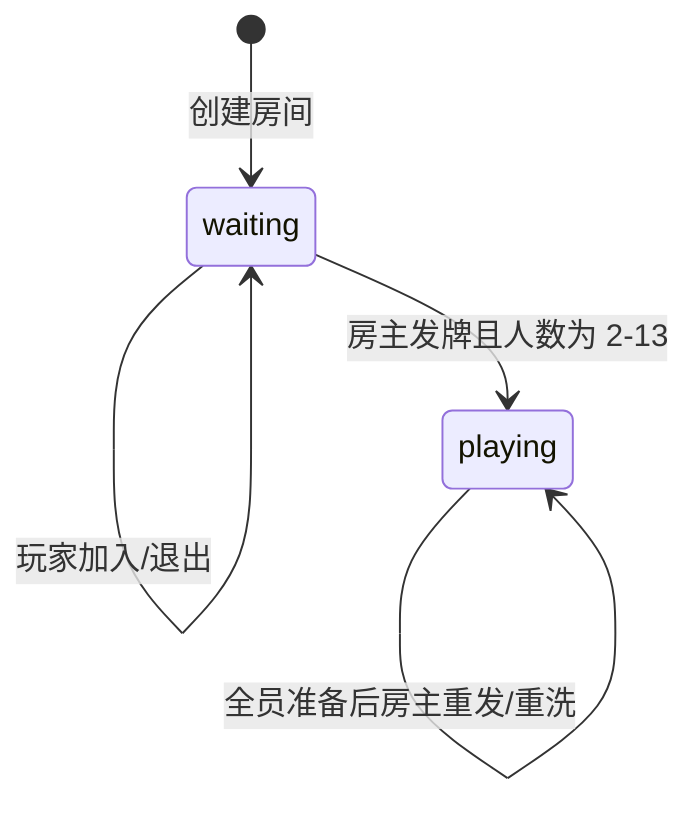

# 广西水鱼扑克牌微信小程序设计

日期：2026-10-09

状态：设计已确认，尚未开始实现

## 1. 项目目标

做一个不替代线下比牌规则的微信小程序，只负责：

- 创建和加入房间。
- 管理 2～13 名玩家。
- 使用一副 54 张扑克牌持续发牌。
- 给每名玩家随机发 4 张牌。
- 让每名玩家在自己的 2×2 四格牌槽中拖动换位。
- 管理“下一局准备”和房主发起下一轮。

玩家在线下当面比较牌型，小程序不参与输赢判断。

## 2. 明确不做

- 不判断水鱼牌型。
- 不比较大小。
- 不记分。
- 不计算输赢。
- 不提供聊天、语音、旁观或 AI 提示。
- 不让玩家查看其他人的手牌。
- 不支持自由摆放、旋转、重叠或自定义牌桌尺寸。

## 3. 核心规则

### 3.1 房间

- 任意玩家可以创建房间。
- 房间使用 6 位数字房间号。
- 玩家可以通过微信分享卡片加入，也可以手动输入房间号加入。
- 房间最少 2 人，最多 13 人。
- 房间满 13 人后不能继续加入。
- 创建者标记为房主。
- 房主可以发起发牌，但必须满足人数和准备条件。
- 房间无操作超过 24 小时后自动失效。

### 3.2 玩家身份

- 使用微信 `openid` 作为唯一身份。
- 不要求注册、手机号、密码或手动创建账号。
- 同一玩家重新进入时恢复原房间、手牌和摆牌位置。
- 同一玩家不能重复占用同一房间的多个席位。

### 3.3 扑克牌

牌组固定为一整副 54 张：

- 四种花色各 13 张：黑桃、红桃、梅花、方块。
- 点数包含 `2`～`10`、`J`、`Q`、`K`、`A`。
- 包含小王和大王。

每张牌使用稳定且唯一的牌 ID，例如：

- `S-A`
- `H-10`
- `C-K`
- `D-2`
- `JOKER-SMALL`
- `JOKER-BIG`

### 3.4 发牌与底牌

房间持有一副持续消耗的牌堆：

1. 首次发牌前，云端将 54 张牌随机洗牌。
2. 每轮按玩家顺序给每人发 4 张。
3. 已发出的牌进入玩家手牌，不回到当前牌堆。
4. 如果当前剩余牌足够所有玩家各发 4 张，则继续从剩余牌中发。
5. 如果当前剩余牌不足，则丢弃旧牌堆的剩余部分，将整副 54 张重新洗牌后再发。
6. 每轮结束时，未发的底牌继续保留。

4 人示例：

| 轮次 | 本轮开始前剩余 | 本轮消耗 | 本轮结束后剩余 |
| --- | ---: | ---: | ---: |
| 第 1 轮 | 54 | 16 | 38 |
| 第 2 轮 | 38 | 16 | 22 |
| 第 3 轮 | 22 | 16 | 6 |
| 第 4 轮 | 6 | 不足 | 重洗为 54，再发 16，剩 38 |

13 人时每轮消耗 52 张，第一轮结束后剩 2 张；下一轮不足，因此重洗整副牌。

### 3.5 手牌与摆牌

- 每名玩家只显示自己的 4 张牌。
- 其他玩家只看到昵称、头像、房主/准备状态和是否已经发牌。
- 四张牌固定在 2×2 的四个槽位中。
- 拖动一张牌到另一格时，两张牌交换位置。
- 不允许旋转、自由移动、重叠或在牌桌其他区域创建新槽位。
- 摆牌结果必须保存；关闭页面或断线重连后恢复相同位置。
- 摆牌不会改变牌的实际点数或花色。

### 3.6 下一局流程

- 首次进入房间时，房间处于等待开局状态。
- 首次发牌不要求玩家准备，只要人数达到 2～13 人，房主即可发牌。
- 发牌后，每名玩家点击“下一局准备”。
- 只有房间内所有当前玩家都准备后，房主才可以点击“重新发牌”。
- 每次发牌后，全部准备状态重置为“未准备”。
- 发牌正在执行时，重复点击发牌按钮不能生成两轮结果。

### 3.7 加入与退出

- 等待开局期间，新玩家可以正常加入并参与第一轮。
- 一轮进行中，新玩家可以进入房间，但标记为“等待下一局”，不能查看本轮手牌。
- 等待下一局的玩家可以提前点击准备；其准备状态只作用于下一轮。
- 如果本轮进行中有人退出，该玩家从当前在座名单移除。
- 退出后剩余人数少于 2 人时，不能继续发牌。
- 当前轮的牌已经发出后，退出玩家的旧手牌不回收到当前牌堆。
- 客户端在前台时每 60 秒更新一次心跳；最近 2 分钟内有心跳的玩家显示为在线。

## 4. 用户界面

### 4.1 首页

提供两个主要操作：

- 创建房间。
- 输入 6 位房间号加入。

### 4.2 房间页

显示：

- 房间号。
- 玩家列表。
- 房主标识。
- 每名玩家的准备状态。
- 在线状态。
- 当前人数和上限。

房主可看到“开始发牌”按钮；非房主只能看到等待状态。

### 4.3 牌桌页

显示：

- 当前轮次。
- 当前剩余底牌数量。
- 自己的 2×2 四张牌。
- 其他玩家的简要状态，不显示其手牌。
- 底部的“下一局准备”或“已准备”按钮。

拖动时高亮目标槽位，松手后完成交换并保存。

## 5. 技术架构

### 5.1 选型

- 原生微信小程序。
- 微信云开发。
- 云数据库存储房间、玩家快照和手牌。
- 云函数处理洗牌、发牌、准备、加入、退出和清理。
- 客户端使用云数据库实时监听房间快照和自己的手牌。

选择该方案的原因：

- 不需要自建服务器。
- 适合 2～13 人的小房间。
- 房间同步和发牌逻辑集中到云端。
- 原生小程序可以减少构建、兼容和发布成本。

### 5.2 组件边界

客户端负责：

- 页面展示。
- 输入房号。
- 发起加入、准备、发牌和摆牌请求。
- 通过实时监听更新界面。
- 播放拖动和换位反馈。

云函数负责：

- 创建并校验 6 位房间号。
- 校验房间容量、身份和房主权限。
- 维护在座玩家、准备状态和在线状态。
- 洗牌、判断底牌是否足够、发牌和重新洗牌。
- 写入每名玩家自己的手牌。
- 防止重复发牌和不同步写入。
- 清理过期房间。

云数据库负责：

- 保存房间权威状态。
- 保存牌堆和隐藏信息。
- 保存每名玩家的手牌及槽位顺序。
- 为实时监听提供可读快照。

### 5.3 数据隔离

权威房间数据与客户端可读数据分开：

- `rooms`：服务端权威数据，包含房间号、房主、玩家身份、状态、牌堆和轮次，不允许普通客户端直接读取。
- `room_views`：每名玩家自己的房间快照，只允许该玩家读取，包含公开玩家列表、准备状态和剩余底牌数量。
- `hands`：每名玩家当前轮次的手牌和槽位，只允许本人读取。

牌堆只能通过云函数访问。客户端不能读取或修改牌堆中的未发牌。

## 6. 数据模型

### 6.1 `rooms`

```text
_id
roomCode
ownerOpenid
status                 waiting | playing
playerOpenids[]
players[] {
  openid
  nickname
  avatarUrl
  joinedRound
  ready
  lastSeenAt
}
roundNumber
deckRemaining[]        // 当前剩余牌 ID，仅服务端可读
deckGeneration         // 当前第几次洗牌
readyOpenids[]
createdAt
updatedAt
expiresAt
```

### 6.2 `room_views`

文档 ID 建议使用 `roomId_openid`：

```text
_id
roomId
openid
roomCode
ownerOpenid
status
roundNumber
remainingDeckCount
players[] {
  openid
  nickname
  avatarUrl
  isOwner
  ready
  online
  hasHand
  joinedRound
}
canDeal
waitingForNextRound
updatedAt
```

### 6.3 `hands`

文档 ID 建议使用 `roomId_roundNumber_openid`：

```text
_id
roomId
openid
roundNumber
cards[] {
  id
  rank
  suit
}
slots[]                // 长度为 4 的卡片索引排列
dealtAt
updatedAt
```

## 7. 核心云函数

- `createRoom`：生成唯一房间号，创建初始牌堆和房主记录。
- `joinRoom`：校验容量和重复加入，创建玩家记录及个人房间快照。
- `leaveRoom`：移除玩家并更新房间快照。
- `setReady`：更新当前轮次的准备状态。
- `dealRound`：校验房主、人数、准备状态和剩余底牌，执行发牌或重洗。
- `arrangeHand`：校验四张牌仍属于本人，保存新的槽位排列。
- `heartbeat`：更新玩家在线时间和个人房间快照。
- `cleanupExpiredRooms`：定时删除过期房间、快照和手牌。

`dealRound` 必须使用事务或等价的原子校验，确保：

- 同一轮不会重复生成手牌。
- 同一牌堆中的同一张牌不会发给两个人。
- 每名玩家恰好获得 4 张牌。
- 准备状态只在新一轮成功创建后清空。

## 8. 状态流转



`waiting` 表示尚未产生任何一轮手牌；首次发牌成功后保持 `playing`，即使后来人数少于 2 人也不删除当前轮次数据，只禁止发起下一轮。

## 9. 异常处理

- 房间号不存在：提示并停留在首页。
- 房间已满：禁止加入。
- 房间失效：提示房间已结束，返回首页。
- 非房主发牌：拒绝请求。
- 人数不足：房主按钮不可用，云端也拒绝请求。
- 未全员准备：房主按钮不可用，云端也拒绝请求。
- 重复发牌：云端返回当前轮次结果，不创建额外牌组。
- 网络中断：保留本地页面，重连后重新拉取自己的房间快照和手牌。
- 云函数失败：显示失败提示，允许用户重试；客户端不能自行发牌。
- 摆牌保存失败：恢复保存前位置并提示重试。

## 10. 测试与验收

### 10.1 规则测试

- 54 张牌包含四种花色各 13 张、大小王各 1 张。
- 2 人房间每轮消耗 8 张。
- 4 人房间底牌数量按 `54 → 38 → 22 → 6 → 重洗 54` 变化。
- 13 人房间每轮消耗 52 张，第二轮前重洗。
- 每名玩家每轮恰好获得 4 张牌。
- 同一轮不出现重复牌。
- 大小王可以正常发到玩家手中。

### 10.2 房间测试

- 创建房间后生成唯一 6 位房间号。
- 微信分享卡片和手动输入房间号均可加入。
- 2 人可以开始，13 人可以坐满，第 14 人不能加入。
- 非房主不能发牌。
- 首次发牌不要求准备，下一轮必须全员准备。

### 10.3 隐私测试

- 玩家只能查询自己的 `hands` 文档。
- 玩家无法读取 `rooms.deckRemaining`。
- 玩家无法通过客户端请求获得其他人的手牌。
- 伪造 `openid` 或房间 ID 不能读取他人手牌。

### 10.4 客户端测试

- 拖动到另一槽位后两牌交换。
- 保存成功后刷新页面，位置不变。
- 保存失败时回退到原位置。
- 手机切后台再进入，恢复房间、手牌和摆牌位置。
- 网络恢复后状态自动同步。

### 10.5 多设备联调

- 使用两台设备完成创建、加入、发牌、准备、重新发牌。
- 使用四台设备验证底牌耗尽后重洗。
- 使用至少 13 个测试身份验证满员和禁止第 14 人加入。

## 11. 完成标准

满足以下条件即可认为首版完成：

- 2～13 名玩家可以通过微信房间号进入同一房间。
- 房主可按规则发牌。
- 每名玩家只看到自己的 4 张牌。
- 玩家可在固定 2×2 牌槽中拖动换位，位置可恢复。
- 下一轮必须全员准备，由房主发起。
- 底牌足够时继续使用，不足时重洗整副 54 张。
- 不包含任何比牌、大小判断或记分功能。
